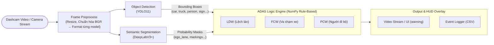

# TÀI LIỆU ĐẶC TẢ BÀI TOÁN & THIẾT KẾ HỆ THỐNG (DEFINE & DESIGN)
**Dự án:** Hệ thống hỗ trợ lái xe ADAS — Phát hiện phương tiện, biển báo & Phân vùng làn đường  
**Tên định danh repo:** `adas-vision`  
**Phiên bản tài liệu:** v1.0  

---

## PHẦN 1: DEFINE (ĐỊNH NGHĨA DỰ ÁN & YÊU CẦU BÀI TOÁN)

### 1.1. Bối cảnh & Mục tiêu (Problem Statement & Objectives)
Trong các hệ thống hỗ trợ lái xe nâng cao (Advanced Driver Assistance Systems - ADAS), việc cảm nhận môi trường thông qua camera gắn trên kính chắn gió (dashcam) đóng vai trò quan trọng. Hệ thống cần đồng thời:
1. **Nhận biết đối tượng (Object Detection):** Xác định vị trí, kích thước và phân loại các thực thể tham gia giao thông (xe hơi, xe buýt, xe tải, xe máy, xe đạp, người đi bộ, người lái xe, đèn tín hiệu và biển báo giao thông).
2. **Phân vùng ngữ nghĩa (Semantic Segmentation):** Phân định chính xác vùng đường có thể di chuyển (drivable area gồm làn hiện tại và làn bên cạnh) cùng hệ thống vạch kẻ đường (lane markings).
3. **Phân tích hành vi & Ra quyết định (ADAS Logic Engine):** Cảnh báo lệch làn/đè vạch (Lane Departure Warning - LDW), cảnh báo nguy cơ va chạm phía trước (Forward Collision Warning - FCW proxy), cảnh báo người đi bộ cắt ngang (Pedestrian Collision Warning - PCW) và nhận diện tín hiệu giao thông.

Mục tiêu : Dự án hướng đến xây dựng một hệ thống hỗ trợ lái xe nâng cao (ADAS) ứng dụng Computer Vision và Deep Learning, sử dụng dữ liệu video từ camera hành trình để nhận diện các đối tượng giao thông, phân vùng khu vực mặt đường, xác định vạch kẻ làn đường và phân tích tình huống giao thông. Trên cơ sở đó, hệ thống tích hợp các thuật toán xử lý và logic ra quyết định nhằm triển khai các chức năng cảnh báo an toàn như cảnh báo lệch làn đường (LDW), cảnh báo nguy cơ va chạm phía trước (FCW), cảnh báo người đi bộ (PCW) và nhận diện tín hiệu giao thông. Qua đó, dự án hướng đến xây dựng một prototype ADAS có khả năng xử lý video, hỗ trợ nhận thức môi trường giao thông và đưa ra cảnh báo kịp thời, góp phần nâng cao tính an toàn trong quá trình tham gia giao thông.

### 1.2. Phạm vi dự án (Project Scope)

#### Trong phạm vi (In-Scope):
* **Huấn luyện / Fine-tune Object Detection:** Sử dụng kiến trúc YOLO (chủ đạo là **YOLO11** từ Ultralytics; kèm khung benchmark so sánh với baseline/phiên bản khác).
* **Huấn luyện / Fine-tune Semantic Segmentation:** Sử dụng mô hình **DeepLabV3+** (backbone ResNet/MobileNet thông qua `segmentation-models-pytorch`).
* **Tập dữ liệu:**
  * **BDD100K:** Tập dữ liệu chính phục vụ huấn luyện và đánh giá đa điều kiện (ngày, đêm, mưa, sương mù, đường đô thị/cao tốc).
  * **Cityscapes:** Tập dữ liệu đô thị chất lượng cao dùng để đánh giá tính khái quát hóa xuyên tập dữ liệu (Cross-Dataset Validation).
* **Logic ADAS Rule-based:** Thuật toán hình học không gian kết hợp giữa bounding box và binary mask (không phụ thuộc vào cảm biến vật lý LiDAR/Radar/CAN-bus).
* **Giao diện & Công cụ thử nghiệm:** CLI xử lý video/camera offline và Web Dashboard (Streamlit) trực quan hóa cảnh báo thời gian thực (HUD overlay).

#### Ngoài phạm vi (Out-of-Scope):
* Không can thiệp điều khiển phần cứng xe thật (ga, phanh, đánh lái tự động).
* Không ước lượng khoảng cách tuyệt đối milimet (do không có camera calibration ma trận nội tại camera hay cảm biến chiều sâu).
* Không phân loại chi tiết hàng trăm mã biển báo theo quy chuẩn địa phương (chỉ phát hiện vùng `traffic_sign` và trạng thái cơ bản).
* Không huấn luyện backbone từ con số 0 (Scratch) — luôn tận dụng Pretrained Weights trên ImageNet/COCO để tiết kiệm tài nguyên GPU.

---

### 1.3. Đặc tả Dữ liệu & Nhãn (Datasets & Labeling Scheme)

#### A. Bộ dữ liệu BDD100K (Berkeley DeepDrive)
* **Đặc điểm:** Ảnh dashcam kích thước gốc 1280x720, bao gồm đa dạng thời tiết, thời điểm và vị trí địa lý.
* **Classes Object Detection (9 lớp chuẩn theo `constants.py`):**
  `0: car`, `1: truck`, `2: bus`, `3: motorcycle`, `4: bicycle`, `5: pedestrian`, `6: rider`, `7: traffic_light`, `8: traffic_sign`.
* **Kênh Segmentation (Multi-label / 3 kênh nhị phân):**
  * Kênh 0: `drivable_direct` — Vùng đường xe đang lưu thông trực tiếp (Ego lane).
  * Kênh 1: `drivable_alternative` — Vùng đường xe có thể chuyển làn sang (làn lân cận).
  * Kênh 2: `lane_marking` — Vạch sơn kẻ đường (vạch liền, vạch đứt, phân làn).

#### B. Bộ dữ liệu Cityscapes
* **Mục đích:** Đánh giá tính tổng quát (Generalization Test) của mô hình DeepLabV3+ và kiểm tra khả năng phân tách ranh giới đường tại các điều kiện chuẩn đô thị.

---

### 1.4. Yêu cầu hệ thống (System Requirements)

#### A. Yêu cầu chức năng (Functional Requirements - FR)
* **FR-1 (Detection):** Phát hiện và xuất bounding box tọa độ pixel `(x1, y1, x2, y2)`, kèm độ tin cậy `conf` và mã `class_id`.
* **FR-2 (Segmentation):** Xuất xác suất điểm ảnh cho 3 kênh (drivable direct, drivable alternative, lane marking).
* **FR-3 (LDW - Lane Departure Warning):** Phát hiện khi trọng tâm đầu xe hoặc vệt bánh xe đè lên vạch phân làn `lane_marking` hoặc lệch khỏi `drivable_direct`.
* **FR-4 (FCW - Forward Collision Warning Proxy):** Tính toán chỉ số đe dọa va chạm dựa trên tỷ lệ diện tích bounding box đối tượng phía trước trong hành lang di chuyển (Ego Corridor) và tốc độ tăng trưởng bounding box qua các frame liên tiếp (Time-to-Collision proxy).
* **FR-5 (Visual Overlay & Event Logging):** Vẽ HUD thông tin lên frame (màu làn, viền xe, khung cảnh báo đỏ/vàng/xanh) và ghi log sự kiện vi phạm vào file CSV/JSON.

#### B. Yêu cầu phi chức năng (Non-Functional Requirements - NFR)
* **NFR-1 (Tốc độ):** Đạt tối thiểu **≥ 15 FPS** khi chạy trọn vẹn pipeline (Detection + Segmentation + ADAS logic) trên GPU Google Colab T4 (hoặc tương đương RTX 3060).
* **NFR-2 (Độ trễ):** Thời gian suy luận và tính toán logic < 65ms/frame.
* **NFR-3 (Bộ nhớ):** VRAM sử dụng trong quá trình inference không vượt quá 6 GB.
* **NFR-4 (Tính module hóa):** Logic ADAS (`src/adas/adas/*`) hoàn toàn độc lập, chỉ thao tác trên mảng NumPy và kiểu dữ liệu chuẩn của Python; không phụ thuộc vào `torch` hay `ultralytics`.

---

### 1.5. Tiêu chí đánh giá & Metrics đo lường (Success Criteria)
Đánh giá độ chuẩn xác: Chỉ số này dao động từ 0 đến 1 (hoặc 0% đến 100%). Giá trị càng cao cho thấy mô hình định vị và nhận diện đối tượng càng chính xác
| Hạng mục | Chỉ số đo lường (Metrics) | Mục tiêu tối thiểu |
| :--- | :--- | :--- |
| **Object Detection** | mAP@0.5 (trên tập BDD100K val, 9 class) | $\ge 0.40$ (riêng lớp `car` $\ge 0.70$) |
| | mAP@0.5:0.95 | $\ge 0.25$ |
| **Segmentation: Drivable Direct** | IoU (Intersection over Union) | $\ge 0.70$ |
| **Segmentation: Lane Marking** | IoU (vạch kẻ đường mỏng) | $\ge 0.30$ (do đặc thù vạch mảnh) |
| **Hệ thống ADAS** | Độ chính xác cảnh báo lệch làn (LDW) | Phản hồi chính xác trên video thực tế, hạn chế báo giả khi chạy thẳng |
| **Tốc độ toàn chu trình** | End-to-end FPS (Inference + ADAS + Overlay) | $\ge 15\text{ FPS}$ |

---

## PHẦN 2: DESIGN (THIẾT KẾ KIẾN TRÚC & KỸ THUẬT)

### 2.1. Kiến trúc hệ thống tổng thể (System Architecture Pipeline)



---

### 2.2. Thiết kế Module 1: Object Detection (YOLO11)

* **Lựa chọn mô hình:** 
  * Mô hình triển khai chính: **YOLO11** (biến thể `yolo11s.pt` cân bằng tốc độ/độ chính xác hoặc `yolo11n.pt` cho siêu nhẹ).
  * Cơ chế đối sánh (Benchmark Suite): Hỗ trợ kiểm thử so sánh hiệu năng giữa các phiên bản YOLO (ví dụ YOLO11 so với các baseline như YOLOv8 hay các biến thể nghiên cứu khác) trên cùng tập dữ liệu chuẩn BDD100K.
* **Kiến trúc cốt lõi YOLO11:**
  * *Backbone:* C3k2 block và SPPF cải tiến kết hợp C2PSA (Cross Stage Partial with Pointwise Spatial Attention) tăng khả năng nắm bắt chi tiết vật thể nhỏ (biển báo, người đi bộ xa).
  * *Head:* Anchor-free, Decoupled Head tối ưu phân loại và hồi quy bbox độc lập.
  * *Loss function:* CIoU/DFL loss cho bounding box và BCE cho classification.
* **Tiêu chuẩn dữ liệu I/O:**
  * Input: Tensor ảnh kích thước chuẩn $(1, 3, 640, 640)$.
  * Output: Danh sách bbox chuẩn hóa theo frame gốc `[x1, y1, x2, y2, confidence, class_id]`.

---

### 2.3. Thiết kế Module 2: Semantic Segmentation (DeepLabV3+)

* **Kiến trúc:** DeepLabV3+ (Encoder-Decoder với Atrous Spatial Pyramid Pooling - ASPP):
  * *Encoder/Backbone:* ResNet-34 hoặc MobileNetV2 (trích xuất đặc trưng đa tầng, giảm tải tính toán).
  * *ASPP:* Sử dụng các tỷ lệ giãn tích chập (atrous dilation rates: 6, 12, 18) để thu thập thông tin ngữ cảnh đa tỷ lệ mà không làm suy giảm độ phân giải không gian.
  * *Decoder:* Phục hồi chi tiết biên độ nét cao của vạch sơn kẻ đường và mép làn xe.
* **Đầu ra (Output Tensors):**
  * Tensor xác suất kích thước $(3, H, W)$ sau hàm kích hoạt Sigmoid (cho Multi-label segmentation).
* **Chiến lược hàm mất mát (Loss Function):**
  * Áp dụng **Combo Loss = BCE (Binary Cross Entropy) + Dice Loss** (hoặc Focal + Tversky Loss) để giải quyết tình trạng mất cân bằng điểm ảnh nghiêm trọng (vạch kẻ đường chỉ chiếm $< 2\%$ diện tích toàn ảnh).

---

### 2.4. Thiết kế Module 3: ADAS Decision Engine (Quy tắc quyết định)

Module ADAS được cô lập hoàn toàn, không phụ thuộc framework Deep Learning, chỉ nhận đầu vào là Bounding Boxes và Segmentation Masks.

#### 1. Bộ cảnh báo lệch làn (Lane Departure Warning - LDW)
* **Nguyên lý:**
  * Xác định tâm xe (Ego Point) tại đáy kính chắn gió: $P_{\text{ego}} = (\frac{W}{2} + \Delta_{\text{offset}}, H - y_{\text{margin}})$.
  * Xác định hành lang an toàn (Ego Corridor) từ mask `drivable_direct`.
  * Tính khoảng cách từ vệt bánh xe trái/phải đến vạch phân làn `lane_marking`.
* **Trạng thái cảnh báo:**
  * `NORMAL (Xanh)`: Xe nằm gọn trong làn `drivable_direct`.
  * `WARNING (Vàng)`: Vệt bánh xe chạm vào vạch kẻ đường `lane_marking`.
  * `DEPARTED (Đỏ)`: Tâm xe vượt qua vạch kẻ hoặc lọt sang làn `drivable_alternative`.

#### 2. Cảnh báo nguy cơ va chạm phía trước (Forward Collision Warning - FCW Proxy)
* **Nguyên lý (do không có khoảng cách vật lý thực tế):**
  * *Vùng quan tâm (ROI):* Chỉ theo dõi các đối tượng `car, truck, bus, motorcycle` nằm trong dải dự kiến di chuyển của xe (chiếu thẳng từ `drivable_direct`).
  * *Độ lớn Bbox:* Đánh giá tỷ lệ chiều cao/diện tích bbox so với khung hình.
  * *Tốc độ tăng trưởng Bbox ($\Delta \text{Area} / \Delta t$):* Nếu diện tích bbox tăng đột biến qua các frame liên tiếp chứng tỏ khoảng cách đang thu hẹp nhanh chóng (xe phía trước phanh gấp hoặc xe mình lao tới).
* **Trạng thái cảnh báo:**
  * `SAFE (Xanh)` $\rightarrow$ `HEADWAY CAUTION (Vàng)` $\rightarrow$ `CRITICAL BRAKE (Đỏ)`.

#### 3. Cảnh báo người đi bộ & phương tiện yếu thế (PCW)
* Theo dõi các lớp `pedestrian`, `bicycle`, `rider`.
* Nếu đối tượng xuất hiện bên trong vùng `drivable_direct` ở nửa dưới khung hình $\rightarrow$ Kích hoạt mức cảnh báo ưu tiên cao nhất (`PEDESTRIAN IN LANE`).

---

### 2.5. Luồng dữ liệu & Quy chuẩn mã nguồn (Data Contracts)

Tuân thủ nghiêm ngặt các nguyên tắc trong dự án:
1. **Hệ màu & Bounding Box:** Frame nội bộ xử lý bằng OpenCV là định dạng `BGR uint8 (H, W, 3)`. Bounding box biểu diễn ở dạng tọa độ tuyệt đối pixel `xyxy` theo kích thước ảnh gốc.
2. **Cấu hình tập trung (YAML):** Tất cả các ngưỡng (IoU threshold, confidence threshold, khoảng cách điểm ego, kích thước box nguy hiểm) phải cấu hình trong file YAML (`configs/adas.yaml`), **tuyệt đối không dùng magic numbers trong mã nguồn**.
3. **Tách lớp mã nguồn:**
   * `src/models/`: Chịu trách nhiệm nạp trọng số, forward và trích xuất kết quả tensor.
   * `src/adas/`: Chỉ xử lý toán hình học vector, mask trên NumPy thuần.
   * `src/visualization/`: Xử lý vẽ UI, bảng thông số HUD, bounding box, overlay màu lên ảnh.

---

### 2.6. Cấu trúc thư mục dự kiến (Repository Layout)

```text
Developing-utility-vehicles-and-regional-transit-networks/
├── configs/                  # File cấu hình YAML
│   ├── detector_yolo11.yaml  # Config huấn luyện/inference YOLO11
│   ├── segmenter_deeplab.yaml# Config DeepLabV3+
│   └── adas_rules.yaml       # Ngưỡng logic LDW, FCW, PCW
├── src/                      # Source code chính của package
│   ├── adas/                 # Logic ADAS thuần NumPy
│   │   ├── ldw.py            # Logic cảnh báo lệch làn
│   │   ├── fcw.py            # Logic cảnh báo va chạm
│   │   └── alert_manager.py  # Tổng hợp sự kiện cảnh báo
│   ├── models/               # Wrapper nạp và suy luận model
│   │   ├── detector.py       # Wrapper YOLO11
│   │   └── segmenter.py      # Wrapper DeepLabV3+ (smp)
    |----- check_point
│   ├── data/                 # Data loaders, augmentations (Albumentations)
│   ├── visualization/        # Vẽ HUD, vẽ mask, render video
│   └── utils/                # Hằng số (constants.py), helper xử lý hình học
├── scripts/                  # Scripts chạy độc lập
│   ├── inspect_dataset.py    # Kiểm tra tính toàn vẹn nhãn BDD100K
│   ├── train_detector.py     # Script gọi huấn luyện YOLO11
│   ├── train_segmenter.py    # Script huấn luyện DeepLabV3+
│   └── evaluate.py           # Tính toán mAP, IoU trên tập Val
├── app/                      # Giao diện tương tác
│   └── streamlit_app.py      # Web demo xem lại video kèm HUD ADAS
├── tests/                    # Unit tests & Integration tests (pytest)
├── docs/                     # Tài liệu thiết kế chi tiết
│   ├ 
│   └── project_description.md
```

---

### 2.7. Lộ trình triển khai (Milestone Roadmap)

* **Milestone 1:** Khởi tạo cấu trúc dự án, nạp config YAML, thiết lập bộ hằng số `constants.py` và các hàm tiện ích hình học.
* **Milestone 2:** Chuẩn bị Pipeline dữ liệu BDD100K (Dataset, DataLoader, Augmentation Albumentations cho segmentation và định dạng Ultralytics cho detection).
* **Milestone 3:** Huấn luyện & Đánh giá Object Detector (YOLO11) trên BDD100K val.
* **Milestone 4:** Huấn luyện & Đánh giá Semantic Segmenter (DeepLabV3+) trên BDD100K drivable/lane masks.
* **Milestone 5:** Phát triển và Unit Test toàn diện cho bộ Logic ADAS (LDW, FCW, PCW).
* **Milestone 6:** Ghép nối Pipeline hoàn chỉnh (End-to-End Inference) và xây dựng giao diện tương tác Streamlit Web App.
* **Milestone 7:** Thử nghiệm trên video thực tế (ngày, đêm, mưa) và đánh giá chéo trên tập dữ liệu Cityscapes.
